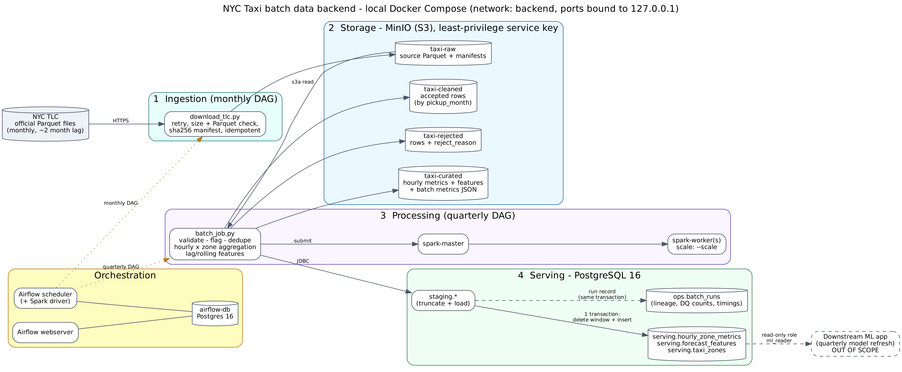

# NYC Taxi Demand and Fare Analytics: Batch Data Pipeline


## 1. Project overview

**Problem.** A taxi-demand forecasting application needs clean, hourly, per-zone demand and fare data, refreshed
every quarter. The raw TLC files are large (millions of rows per month), contain invalid records (for example
negative fares or trips that end before they start) and are published monthly.

**Solution.** A batch system with two scheduled workflows:

| Workflow | Schedule | What it does |
|---|---|---|
| `taxi_ingest_monthly` | 15th of every month, 02:00 | Downloads the newest published month of TLC data into the raw object-store bucket, with size, Parquet and schema checks and a SHA-256 manifest |
| `taxi_process_quarterly` | 15th of Feb, May, Aug, Nov, 04:00 | Runs the Spark job over the quarter's months, then publishes the results to PostgreSQL and verifies them |

**Dataset.** NYC TLC yellow-taxi trip records (Parquet, one file per month). The demo uses January 2024:
2,964,624 time-referenced records, above the assignment's 1,000,000-record minimum.

**Frequency.** Ingestion is monthly and delivery to the ML application is quarterly, matching the TLC publishing
rhythm and the model's retraining cycle.

## 2. Architecture and technology



Every component is an isolated Docker Compose service on a private network; all published ports are bound to
`127.0.0.1` (nothing is exposed to the local network).

| Layer | Service | Technology | Role |
|---|---|---|---|
| Ingestion | Airflow DAG `taxi_ingest_monthly` + `src/ingestion` | Python, requests | Idempotent, verified download to the `taxi-raw` bucket |
| Storage | `minio` + `minio-init` | S3-compatible object store, Parquet | Data-lake layers: `taxi-raw`, `taxi-cleaned`, `taxi-rejected`, `taxi-curated` |
| Processing | `spark-master`, `spark-worker`; `src/spark` | Apache Spark 3.5.3 (PySpark) | Validate, flag, deduplicate, aggregate, build features |
| Orchestration | `airflow-webserver`, `airflow-scheduler`, `airflow-db`, `airflow-init` | Apache Airflow 2.10.5 (LocalExecutor) | Schedules, retries, dependencies, verification step |
| Serving | `postgres` | PostgreSQL 16 | Query-ready tables, read-only role for the ML application |

Nine services in total: `minio`, `minio-init`, `postgres`, `spark-master`, `spark-worker`, `airflow-db`,
`airflow-init`, `airflow-webserver`, `airflow-scheduler`. The Airflow scheduler container also acts as the Spark
driver (it has Java 17 and PySpark installed).

## 3. Data flow

```
TLC website (Parquet, monthly)
        |  HTTPS download, retries, size/Parquet/schema checks, SHA-256 manifest
        v
[1] taxi-raw            original monthly file + manifest (lineage, source URL, checksum)
        |  Spark: s3a read, normalise schema
        v
[2] Validate and flag   every row gets either "accepted" or exactly ONE rejection reason
        |
        +--> taxi-rejected   rejected rows with their reason (kept for audit)
        |
        v  accepted rows, duplicates removed
[3] taxi-cleaned        cleaned trips, partitioned Parquet
        |
        v  aggregate by pickup hour x pickup zone, then dense hour x zone grid + features
[4] taxi-curated        hourly metrics, forecast features, batch metrics JSON
        |  JDBC load into staging.* tables (truncate + load)
        v
[5] PostgreSQL          ONE transaction: delete window + insert into serving.*, write ops.batch_runs
        |
        v
ML application (read-only role `ml_reader`)
```

Key rules (full list in [docs/data_quality_rules.md](docs/data_quality_rules.md)):
- **One reason per rejected row**: `null_pickup_ts`, `null_dropoff_ts`, `pickup_outside_window`,
  `non_positive_duration`, `duration_exceeds_max`, `null_pickup_zone`, `null_fare`, `negative_fare`,
  `fare_exceeds_max`, `null_distance`, `negative_distance`, `distance_exceeds_max`, `duplicate`.
- **Invariants checked after every run**: `source rows = accepted + rejected` and `sum(trip_count) = accepted`.
- **Timestamps**: TLC NYC wall-clock times are never shifted; windows are half-open `[start, end)`.
- **Forecast features**: dense zone x hour grid, calendar features (ISO day of week), lag features
  (1 h, 24 h, 168 h) and a rolling mean of the 24 *preceding* hours, so no target leakage.
- **Idempotency**: deterministic `batch_id`, partition overwrite in the object store and an atomic
  delete-and-insert in PostgreSQL, so re-running a month replaces its data instead of duplicating it.

## 4. Data model

Schemas in PostgreSQL (`sql/02_tables.sql`):

| Table | Content |
|---|---|
| `serving.hourly_zone_metrics` | Per pickup hour and zone: `trip_count`, `avg_fare`, `p50_fare`, `p90_fare`, fare and distance sums/averages, average duration and passengers, `batch_id`, `loaded_at` |
| `serving.forecast_features` | Per pickup hour and zone: targets (`target_trip_count`, `target_avg_fare`), calendar features, `lag_1h/24h/168h_trip_count`, `rolling_mean_24h_trip_count`, `lag_1h_avg_fare`, `batch_id` |
| `serving.taxi_zones` | TLC zone lookup (`location_id`, borough, zone, service zone) |
| `serving.v_hourly_zone_metrics_named` | View joining metrics with zone names |
| `ops.batch_runs` | One row per batch: row counts (source/accepted/rejected), reject breakdown (JSON), timings, throughput, Spark configuration, status |
| `staging.*` | Working copies, truncated and refilled by each run |

Database roles: `etl_writer` (staging, serving and ops only) and `ml_reader` (read-only on `serving`).

## 5. Quick start

These steps were used on Windows 11 with Docker Desktop (WSL 2 backend) and an Ubuntu terminal. On Linux or macOS
skip the WSL parts.

### 5.1 Requirements
- Docker Desktop (or Docker Engine) with Compose v2; on Windows turn on the WSL 2 backend and WSL integration for Ubuntu.
- About 8 GB RAM in total (a one-month run works within 5 GB given to Docker; see the low-memory option below),
  about 10 GB free disk.
- Internet access for the first start (Docker images, Spark JAR packages, TLC files from `d37ci6vzurychx.cloudfront.net`).
- On Windows with 8 GB RAM, limit WSL in `%UserProfile%\.wslconfig`:
  ```
  [wsl2]
  memory=5GB
  processors=2
  ```
  then run `wsl --shutdown` in PowerShell and restart Docker Desktop.

### 5.2 Get the code
```bash
git clone https://github.com/kishlaykumar990-hue/nyc-taxi-batch-data-pipeline.git
cd nyc-taxi-batch-data-pipeline
```
On Windows, keep the project inside the Ubuntu file system (for example in your home directory), not under `/mnt/c`.

### 5.3 Create the configuration file
`.env` holds all passwords and settings and is git-ignored. Generate it with random passwords:
```bash
python3 scripts/setup_env.py              # standard memory settings
python3 scripts/setup_env.py --low-memory # 8 GB laptops: Spark runs in local[2] mode, 2 GB driver
```
The script prints the Airflow and MinIO logins; you can read them again in `.env` at any time. It refuses to
overwrite an existing `.env`. (Alternative: `cp .env.example .env` and replace every `change_me_*` value.)

### 5.4 Start the stack
```bash
docker compose up -d --build
docker compose ps
```
The first start downloads images and builds the Airflow image (several minutes). Wait until `postgres`,
`spark-master`, `airflow-db` and `airflow-webserver` are `healthy`; `airflow-init` and `minio-init` should show
`Exited (0)`, which is expected (they are one-off jobs).

If the object-store image cannot be pulled, set `MINIO_IMAGE` in `.env` to the alternative named there.

## 6. Running the pipeline

Run each command separately.

```bash
# 1. Enable the two workflows (they start paused)
docker compose exec airflow-scheduler airflow dags unpause taxi_ingest_monthly
docker compose exec airflow-scheduler airflow dags unpause taxi_process_quarterly

# 2. Ingest January 2024
docker compose exec airflow-scheduler airflow dags trigger taxi_ingest_monthly --conf '{"months":"2024-01"}'

# 3. When the ingest run shows "success" in Airflow, process it
docker compose exec airflow-scheduler airflow dags trigger taxi_process_quarterly --conf '{"months":"2024-01"}'
```
Watch progress in the Airflow UI (http://localhost:8081). Ingestion takes about a minute; processing took about
5 minutes for January 2024 on an 8 GB laptop.

Notes:
- Unpausing a workflow can create an automatic "scheduled" catch-up run. It is harmless; pause the workflow
  afterwards with `airflow dags pause <dag_id>` if it keeps running.
- Only one processing run is allowed at a time (`max_active_runs=1`); a second one waits in the queue.
- Development sample: `--conf '{"months":"2024-01","sample_fraction":0.05}'` (the 1,000,000-row check will then,
  correctly, fail).
- Scheduled operation needs no manual trigger: ingestion runs on the 15th of each month (ingesting the month
  published two months earlier) and processing on the 15th of Feb/May/Aug/Nov over the quarter's last three months.

## 7. Verifying the result

```bash
docker compose exec airflow-scheduler python /opt/project/scripts/verify_pipeline.py --months 2024-01 --skip-services
```
This runs 15 checks (tables exist, batch status, at least 1,000,000 source rows, source = accepted + rejected,
aggregates reconcile with accepted rows, dense feature grid, no null keys, timestamps inside the window, raw
manifest present, object counts) and prints PASS/FAIL for each.

Example queries (busiest zones, demand by hour of day, weekday vs weekend, one zone's time series, data-quality
summary):
```bash
docker compose exec -T postgres psql -U postgres -d taxi -f /sql/queries/example_queries.sql
```
See which Spark mode a run used:
```bash
docker compose exec -T postgres psql -U postgres -d taxi -c "SELECT batch_id, config->>'spark_master' AS spark_master, config->>'shuffle_partitions' AS partitions FROM ops.batch_runs;"
```

## 8. Interfaces and endpoints

**This project does not expose a REST API.** The batch system delivers data through PostgreSQL tables, which is
the interface the ML application reads. The web consoles below are for operating and inspecting the system.
All are reachable on localhost only.

| Interface | Address | Login | Purpose |
|---|---|---|---|
| Airflow UI | http://localhost:8081 | `AIRFLOW_ADMIN_USER` / `AIRFLOW_ADMIN_PASSWORD` from `.env` (default user `admin`) | Run, pause and monitor the two workflows, read task logs |
| Spark Master UI | http://localhost:8080 | none | Cluster, workers and applications (when the cluster mode is used) |
| Object-store console | http://localhost:9001 | `MINIO_ROOT_USER` / `MINIO_ROOT_PASSWORD` from `.env` | Browse the four `taxi-*` buckets |
| Object-store S3 API | http://localhost:9000 | same root account | S3-compatible access used by Spark and the ingestion code |
| PostgreSQL | `localhost:5433`, database `taxi` | `ml_reader` (read-only) or `etl_writer`; passwords in `.env` | Query `serving.*` and `ops.batch_runs` |

Example read-only connection for the ML application:
```bash
psql -h localhost -p 5433 -U ml_reader -d taxi -c "SELECT * FROM serving.forecast_features LIMIT 5;"
```

## 9. Configuration

Everything is in `.env` (template: `.env.example`); no code change is needed to alter these.

| Setting | Meaning |
|---|---|
| `PIPELINE_MONTHS` | Default months for manual runs (YYYY-MM, contiguous, comma-separated) |
| `SAMPLE_FRACTION` | 1.0 = all data; use for example 0.05 for a development sample |
| `MAX_TRIP_HOURS`, `MAX_TRIP_DISTANCE_MILES`, `MAX_FARE_AMOUNT` | Plausibility limits used by the data-quality rules |
| `MIN_SOURCE_ROWS` | Assignment threshold checked by the verification script (1,000,000) |
| `SPARK_MASTER` | `spark://spark-master:7077` (cluster) or `local[2]` (low-memory fallback, used when generated with `--low-memory`) |
| `SPARK_DRIVER_MEMORY`, `SPARK_EXECUTOR_MEMORY`, `SPARK_WORKER_MEMORY`, `SPARK_WORKER_CORES`, `SPARK_SHUFFLE_PARTITIONS` | Spark resources |
| `MINIO_IMAGE` | Object-store image (configurable because the original public image was withdrawn) |
| `TLC_BASE_URL`, `TLC_ZONE_LOOKUP_URL` | Data source locations |

More Spark workers: `docker compose up -d --scale spark-worker=2`.

## 10. Project structure

```
.
├── docker-compose.yml          # the nine services (infrastructure as code)
├── .env.example                # configuration template (copy/generate .env; never commit it)
├── dags/                       # Airflow workflows (taxi_ingest_monthly, taxi_process_quarterly, shared helpers)
├── src/
│   ├── common/                 # config, schema contract, month handling, S3 and storage helpers
│   ├── ingestion/              # TLC download with retries and checksum manifest
│   ├── spark/                  # transform.py (pure functions) and batch_job.py (Spark job)
│   ├── publish/                # atomic PostgreSQL publish
│   └── verify/                 # verification checks
├── sql/                        # roles/schemas, tables, grants, init script, example queries
├── scripts/                    # setup_env.py, init_buckets.py, spark_submit.sh, verify_pipeline.py, benchmark.sh, make_synthetic_tlc.py
├── docker/airflow/             # Airflow image (Java 17 + PySpark)
├── tests/                      # unit and integration tests
├── docs/                       # architecture diagram, data-quality rules, security/governance, compliance checklist
├── benchmarks/RESULTS.md       # measured results
└── portfolio/                  # course portfolio texts
```

Further documentation: [data quality rules](docs/data_quality_rules.md) ·
[security & governance](docs/security_governance.md) · [compliance checklist](docs/compliance_checklist.md) ·
[benchmarks](benchmarks/RESULTS.md)

## 11. Tests

The tests run inside the Airflow image, which already contains Java 17 and PySpark. Start the stack first
(`docker compose up -d`), then run each command as one line from the project folder.

**Unit tests** (transformation rules, month handling, feature logic; 44 tests):
```bash
docker compose run --rm --no-deps --entrypoint bash -v "$PWD/tests:/opt/project/tests:ro" -v "$PWD/pytest.ini:/opt/project/pytest.ini:ro" -w /opt/project airflow-scheduler -c "pip install -q pytest pandas pyarrow && python -m pytest tests/unit -p no:cacheprovider -q"
```

**Integration tests** (atomic publish, idempotency, role permissions against the real PostgreSQL 16; 7 tests):
```bash
docker compose run --rm --no-deps --entrypoint bash -e ML_DB_PASSWORD="$(grep '^ML_DB_PASSWORD=' .env | cut -d= -f2-)" -v "$PWD/tests:/opt/project/tests:ro" -v "$PWD/pytest.ini:/opt/project/pytest.ini:ro" -w /opt/project airflow-scheduler -c "pip install -q pytest psycopg2-binary && python -m pytest tests/integration -p no:cacheprovider -q"
```

> **Warning.** The integration tests publish small test batches (batch ids starting `it_`, dated 2031-2035) into the
> real `serving` and `ops` tables and do not remove them. Run them against a throwaway database, or delete the test
> rows afterwards, otherwise `verify_pipeline.py` reports "timestamps within batch window" as failed:
> ```bash
> docker compose exec -T postgres psql -U postgres -d taxi -c "DELETE FROM serving.hourly_zone_metrics WHERE batch_id LIKE 'it_%'; DELETE FROM serving.forecast_features WHERE batch_id LIKE 'it_%'; DELETE FROM ops.batch_runs WHERE batch_id LIKE 'it_%'; TRUNCATE staging.hourly_zone_metrics, staging.forecast_features;"
> ```
> The real batch (`yellow_2024-01_2024-01`) is not affected.

## 12. Reliability, scalability, maintainability, security

- **Reliability**: retries with exponential backoff, health checks and `depends_on` conditions, restart policies,
  idempotent ingestion, idempotent object writes, atomic PostgreSQL publish, and reconciliation guards that fail
  the run instead of publishing wrong data.
- **Scalability**: partitioned Parquet, configurable shuffle partitions, more Spark workers via `--scale`.
- **Maintainability**: environment-based configuration, pure transform functions with unit tests, everything
  defined as code and versioned in Git.
- **Security and governance**: secrets only in the git-ignored `.env`, least-privilege database roles, localhost-only
  ports, lineage (source URL, checksums, `batch_id` on every served row, `ops.batch_runs`), rejected rows kept with
  reasons. Details and limitations: [docs/security_governance.md](docs/security_governance.md).

## 13. Troubleshooting

| Symptom | Fix |
|---|---|
| `Cannot connect to the Docker daemon` | Start Docker Desktop and wait for "Engine running"; enable WSL integration for Ubuntu |
| Compose says a variable is missing | Fill it in `.env` (or regenerate with `scripts/setup_env.py`) |
| `pull access denied` for the object-store image | Set `MINIO_IMAGE` in `.env` to the alternative image named in `.env.example` |
| Processing run stays "queued" | Another processing run is active (`max_active_runs=1`); wait or pause the catch-up run |
| Spark job cannot reach the driver | Workers must resolve `airflow-scheduler` (same Compose network); `SPARK_MASTER=local[2]` bypasses the cluster |
| First run is slow | Spark downloads S3A/JDBC JARs once (cached in the `ivycache` volume) |
| Out of memory | Use `--low-memory`, process one month, lower `SPARK_SHUFFLE_PARTITIONS`, or raise the WSL memory limit |
| "Month not found" | TLC publishes with about a two-month delay |

## 14. Status and limitations

**Verified by the author** on a Windows laptop (Docker Desktop, WSL 2, 8 GB RAM, WSL limited to 5 GB): `docker compose up`,
object-store bucket bootstrap, both Airflow workflows, the real TLC download, the Spark batch job and the publish
to PostgreSQL for **January 2024**:

| Result | Value |
|---|---|
| Source rows | 2,964,624 |
| Accepted / rejected | 2,926,252 / 38,372 (1.29 %), mostly `negative_fare` |
| Hourly zone rows / feature rows | 77,469 / 193,440 (260 zones x 744 hours) |
| Processing time | 302 s (about 9,800 rows/s), single run |
| Verification script | 15 of 15 checks passed |

**How Spark ran.** The verified January 2024 run used Spark in local mode (`local[2]`, 8 shuffle partitions) inside the
Airflow scheduler container, chosen because of limited memory (Windows 11, Docker Desktop with WSL 2, 8 GB RAM, WSL
limited to 5 GB). The standalone Spark master and worker start with the stack, but this run did not use them. Cluster
mode (`SPARK_MASTER=spark://spark-master:7077`) has not been tested in this environment.

**Tests.** In this environment (Docker Desktop, WSL 2) the 44 unit tests passed (81.7 s) and the 7 PostgreSQL
integration tests passed (2.1 s), both run inside the Airflow container as described in section 11. After the
integration run, the test rows it leaves behind were deleted and the verification script again reported 15 of 15
checks. Benchmark results and timings: [benchmarks/RESULTS.md](benchmarks/RESULTS.md).

**Known limitations**
- Single-node local deployment; the benchmark is one run on one month, not a statistical study. The effect of
  different partition counts and of multi-month inputs was not measured.
- No TLS and no encryption at rest.
- The object store is accessed with its root account because its public images and admin client are no longer
  distributed (see [docs/security_governance.md](docs/security_governance.md)).
- Failure alerts are log-only.
- Unpausing the processing workflow creates a scheduled catch-up run (pause it or mark it failed).
- No streaming path; a real-time extension (Kafka plus Spark Structured Streaming reusing the same validation
  rules) is described only as a design strategy in the course report.

## 15. Cleanup

```bash
docker compose down        # stop and remove containers, KEEP data
docker compose down -v     # stop and DELETE all data volumes (starts from scratch)
```
## License
Submitted as an academic portfolio project for IU Internationale Hochschule (DLMDSEDE02). All rights reserved.
